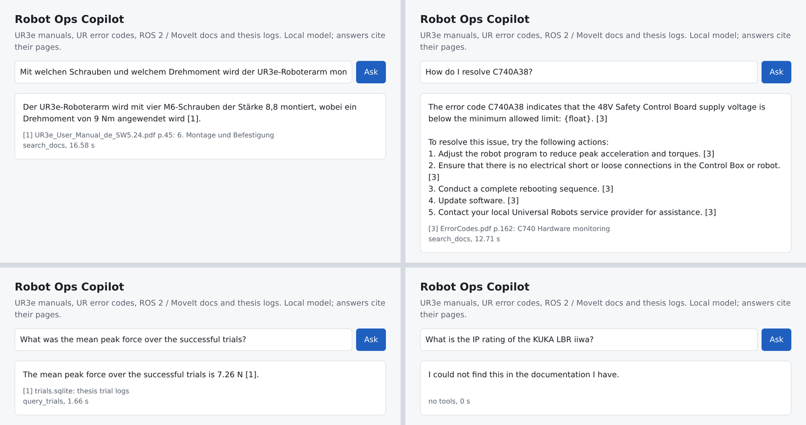

# Robot Ops Copilot

A local, bilingual (English / German) support copilot for a UR3e cell running ROS 2 Humble and MoveIt 2. It answers
from the UR3e user manual, the UR Error Codes Directory, the ROS 2, MoveIt 2 and UR driver docs, and the config
files and logged trials of my master's thesis stack. Every answer cites the page it came from, or the copilot says
it could not find it. Everything runs on one laptop (RTX 3060, 6 GB); no question or document leaves the machine.



*Four questions through the service page: a German manual question, an error code, a question the agent answers
with SQL over the trial logs, and one about another robot, which it refuses.*

## Results

Evaluation set: 133 hand-written questions (dev / test split, every third one is dev) plus a held-out set of 49
written before the cycle-2 fixes and never used to choose anything. Grading is deterministic: an answer is correct
when every required fact group appears in it (any accepted spelling, decimal comma = point), an out-of-scope
question is correct when the copilot refuses. No LLM judge.

**Answers** (qwen2.5:7b, Q4, via Ollama; reranker on CPU)

| config | main (133) | dev (45) | test (88) | held-out (49) | false refusals (main) | p50 s | p95 s |
|---|---|---|---|---|---|---|---|
| agent, hybrid + small reranker (shipped) | **96.2%** (128) | 44/45 | 84/88 | **91.8%** (45) | 1 | 7.3 | 17.9 |
| agent, hybrid, no reranker | 87.2% (116) | 40/45 | 76/88 | | 11 | 5.0 | 12.1 |
| plain RAG (one retrieval, no tools) | 82.0% (109) | 38/45 | 71/88 | 87.8% (43) | 20 | 7.2 | 10.7 |
| agent with qwen2.5:3b | 68.4% (91) | 32/45 | 59/88 | | 32 | 4.9 | 8.4 |

No invalid citations in any run: the guard removes a citation number that was not given, and an answer without a
citation is retried once and otherwise refused.

Per question type (main set):

| config | manual | manual (de) | error code | fault symptom | ROS 2 | MoveIt | UR driver | thesis param | trials (SQL) | out of scope |
|---|---|---|---|---|---|---|---|---|---|---|
| agent 7B | 21/22 | 13/13 | 14/15 | 6/7 | 19/19 | 10/10 | 9/10 | 9/9 | 14/14 | 13/14 |
| no reranker | 21/22 | 8/13 | 14/15 | 4/7 | 19/19 | 10/10 | 7/10 | 5/9 | 14/14 | 14/14 |
| plain RAG | 21/22 | 11/13 | 12/15 | 6/7 | 19/19 | 10/10 | 8/10 | 8/9 | 0/14 | 14/14 |
| agent 3B | 16/22 | 5/13 | 6/15 | 6/7 | 14/19 | 10/10 | 4/10 | 7/9 | 11/14 | 12/14 |

**Retrieval** (hit = a gold page in the top k; question set without the out-of-scope questions)

| retriever | main R@1 | main R@5 | main MRR | held-out R@1 | held-out R@5 | p50 latency |
|---|---|---|---|---|---|---|
| BM25 | 0.60 | 0.85 | 0.70 | 0.63 | 0.76 | 8 ms |
| dense (bge-m3) | 0.71 | 0.90 | 0.79 | 0.63 | 0.95 | 144 ms |
| hybrid (RRF) | 0.71 | 0.90 | 0.80 | 0.71 | 0.90 | 153 ms |
| hybrid + mMiniLM reranker (shipped) | **0.84** | **0.99** | **0.90** | 0.71 | 0.95 | 1.8 s |
| hybrid + bge-reranker-v2-m3 | 0.82 | 0.99 | 0.89 | 0.73 | 0.98 | 15.7 s |

105 answerable main questions with a gold page, 41 held-out (trial and out-of-scope questions have no page). The
reranker runs on CPU because the 7B model fills the GPU.

What the numbers say:

- The agent beats plain RAG by 14 points on the main set and 4 on held-out, mostly because questions about the
  logged trials need SQL (RAG gets 0/14 there) and because the error-code lookup is exact. Plain RAG refuses more
  often (20 false refusals), which is also why it never answers an out-of-scope question.
- The cross-encoder reranker is the biggest single win: R@1 0.71 to 0.84 on the main set, and 87% to 96% answer
  accuracy (German manual questions 8/13 to 13/13). The large bge-reranker-v2-m3 is no better on the main set and
  2 to 3 points better on held-out, at almost 9x the latency, so the service uses the small one.
- The 3B model is fast but drops facts and refuses answerable questions; 7B is the smallest model I would ship.
- Dev and test are close (98% vs 95%); the held-out set is 4 points lower (92%), which is the honest number to
  expect on new questions.

## How it works

```
question ─► other-robot check ─► router ─┬─ trial question ─► query_trials (SQL over the logs) ─┐
                                         └─ search_docs (BM25 + bge-m3, RRF, cross-encoder) ──┤
                                                                                              ▼
                     qwen2.5:7b writes the answer from numbered passages, no tools offered at first
                                                                                              │
                     refuses? ─► nudged once to call a tool: lookup_error_code, get_parameter,
                                 query_trials, search_docs with a better query or source filter
                                                                                              ▼
                     citation guard: drop invalid [n], retry an uncited or empty answer, else refuse
                                                                                              ▼
                                 answer + cited pages + tool calls ─► audit log (JSONL)
```

- **Ingestion** (`copilot/ingest.py`): PDFs into 220-word windows with 40 words overlap, each page carrying the
  start of the next one (spec tables often break over pages). The Error Codes Directory is parsed into 1222 codes
  in 226 groups. rst / md docs are chunked by section. Thesis YAML is flattened into parameters, the trial CSVs go
  into typed SQLite tables. 4936 chunks.
- **Retrieval** (`copilot/retrieve.py`): BM25 and dense bge-m3 fused with reciprocal rank fusion, then a
  multilingual cross-encoder. A question with an error code also gets that code's entry, by exact match.
- **Tools** (`copilot/tools.py`): `search_docs`, `lookup_error_code`, `query_trials` (read-only, SELECT / WITH
  only, returns the schema on an SQL error), `get_parameter` (exact or substring match, never a fuzzy value).
- **Agent** (`copilot/agent.py`): retrieval first, tools only after a refusal. Each rule in the code comments says
  which evaluation cycle found the failure it fixes.
- **Service** (`serve/app.py`): FastAPI with `/ask`, `/audit`, `/health` and a small page at `/`.

## Traceability (audit log)

Every request is appended to `data/logs/audit.jsonl`: time, request id, question, model and retrieval settings,
every tool call with its arguments, the ids of all passages the model saw, the answer, the cited pages, guard flags
and latency. That is what makes an answer checkable after the fact: which page of which manual it came from and
which model wrote it, in the spirit of the EU AI Act's record-keeping and transparency duties. A copilot like this
is not high-risk under the Act on its own; the log is there because a service technician has to be able to see
why the copilot said what it said.

## Evaluation cycles

Each cycle: run the full set, read every failure, fix the cause, run again. Only the dev split and the failures
of earlier cycles drove changes; the held-out set was only measured.

| cycle | main (133) | dev | test | held-out (49) | what the failures were, what changed |
|---|---|---|---|---|---|
| 1 | 66.2% | 30/45 | 58/88 | | model-written search queries were weak, fuzzy parameter matches gave wrong values, SQL compared numbers stored as text, the model copied the example error code from the prompt. Now: retrieve with the question first, exact parameter match, typed SQLite, exact error-code routing |
| 2 | 73.7% | 36/45 | 62/88 | | copied a concrete example answer from the prompt, a relevance gate refused 28 answerable questions, spec values sat in the next chunk. Now: neutral examples, next-window context, gate chosen offline on dev |
| 3 | 89.5% | 40/45 | 79/88 | | offering tools up front made the 7B refuse questions its passages answered; trial questions got distracted by ROS tutorial passages. Now: staged agent (tools only after a refusal), intent router to SQL |
| 4 | 89.5% | 44/45 | 75/88 | 91.8% | the gate picked on dev was now "off"; dev 98% vs test 85% showed the dev split was overfit |
| 5 | **96.2%** | 44/45 | 84/88 | **91.8%** | "Range: [100 - 3000]" in a passage read as a citation, answers about the KUKA iiwa / UR5e / Franka given with UR3e values, error answers that skipped what the code means, 3B answering with a bare "[1]". Now: brackets in passages become parentheses, other-robot check, error-meaning rule, empty-answer retry |

Cycle 5 is where I stopped changing the agent: the remaining misses are reading mistakes of the 7B model or data
problems, and three of the five are on the test split, so fixing them one by one would mean tuning on test.

Grader changes, all for answers that stated the right fact in a different spelling, listed in
`eval/make_questions.py`: 0.25 m/s for 250 mm/s, "read head" for readhead, 73.68 for 73.7, "script" for URScript,
"12-V" for 12 V.

## Limitations

- The 7B model still misreads or leaves out facts: it drops one of two required facts (q048, q088), and for a
  symptom that matches several error codes it gives the generic steps of one (q050).
- Asked for a value that does not exist, it sometimes hedges ("not mentioned, however the closest is ...") instead of
  refusing (q128, h047). The refusal check only catches refusals that start the answer.
- One manual question (mains voltage) fails because PyMuPDF loses the values of that spec table.
- One held-out miss is a grader spelling ("inertial measurement unit" for IMU), left as is because the held-out
  grader was fixed before the run.
- The other-robot check is a word list (UR5e, UR10e, KUKA, Franka, ABB, Fanuc ...). Two of the three failures that
  motivated it were on the main set, one on the held-out set, so the held-out score is not fully blind to that rule.
- 133 + 49 questions written by one person; the numbers have a few points of noise.
- The thesis config files and trial logs are not public yet (they will be with the thesis), so the `param` and
  `trials` questions cannot be rerun from this repo alone.

## Run it

```
# models (a second Ollama with the models on a data disk works too: set OLLAMA_HOST)
ollama pull qwen2.5:7b && ollama pull bge-m3

python3.11 -m venv .venv && . .venv/bin/activate
pip install torch==2.11.0 --index-url https://download.pytorch.org/whl/cu128   # before the rest
pip install -r requirements.txt

scripts/fetch_corpus.sh      # ROS 2 / MoveIt / UR driver docs at the evaluated revisions
# UR PDFs into data/corpus/ur/ (free from universal-robots.com, not redistributed here):
#   UR3e_User_Manual_en_SW5.24.pdf, UR3e_User_Manual_de_SW5.24.pdf (e-Series SW 5.24 user manual), ErrorCodes.pdf

python -m copilot.ingest                 # chunks, error codes, parameters, trials
python -m copilot.retrieve --build       # dense index (GPU, about 8 minutes)
python -m copilot.agent "Was bedeutet der Fehler C153A1?"
uvicorn serve.app:app --port 8100        # http://127.0.0.1:8100

python eval/run.py retrieval
python eval/run.py answers --pipeline agent --model qwen2.5:7b --rerank small --tag agent_7b
python eval/run.py answers --qset heldout --tag heldout_agent_7b
python eval/run.py summary
python -m pytest -q tests                # fixture index and fake LLM, no models needed (also in CI)
```

Earlier cycles' raw answers are in `results/cycle*/`.
